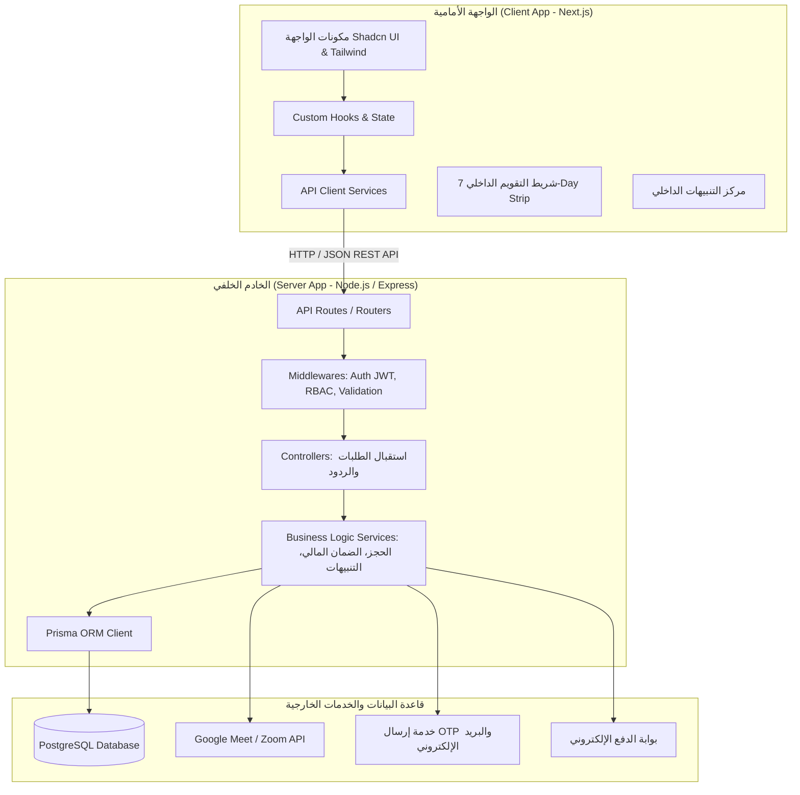

# وثيقة الهيكل المعماري وتنظيم المشروع (Architecture & Project Blueprint)
## منصة مسار للاستشارات (Masser Platform)
**الإصدار:** 1.0  
**النمط المعماري:** مفصول (Decoupled Client-Server Architecture)  
**التقنيات:** Frontend (Next.js + Tailwind CSS + Shadcn UI) | Backend (Node.js/Express + TypeScript + Prisma ORM + PostgreSQL)

---

## 1. المخطط المعماري العام (High-Level Architecture)



---

## 2. الهيكل التفصيلي للمجلدات (Folder Structure Blueprint)

المشروع مقسم إلى مجلدين رئيسيين في المسار الجذري (`client` و `server`) وفق التنظيم الطبقي التقليدي (**Layer-based Architecture**):

```
masser/
├── client/                          # تطبيق الواجهة الأمامية (Next.js)
│   ├── public/                      # الصور الثابتة، الأيقونات، الخطوط
│   ├── src/
│   │   ├── app/                     # مسارات الصفحات وتخطيطات Next.js (App Router)
│   │   │   ├── (auth)/              # مسارات المصادقة: login, register, otp, forgot-password
│   │   │   ├── (dashboard)/         # مسارات لوحات التحكم المحمية
│   │   │   │   ├── client/          # لوحة تحكم العميل، الحجوزات، المحفظة
│   │   │   │   ├── expert/          # لوحة تحكم الخبير، الجداول، الخدمات، الأرباح
│   │   │   │   └── admin/           # لوحة الإدارة، المراجعة، المدفوعات، الصلاحيات
│   │   │   ├── experts/             # استكشاف الخبراء وملف الخبير العام
│   │   │   ├── booking/             # مسار شاشة الحجز والدفع
│   │   │   ├── layout.tsx           # التخطيط العام وتوجيه اللغة RTL
│   │   │   └── page.tsx             # الصفحة الرئيسية (Landing Page)
│   │   │
│   │   ├── components/              # المكونات الرسومية وتوزيعها الطبقي
│   │   │   ├── ui/                  # عناصر Shadcn UI (buttons, dialogs, badges, inputs...)
│   │   │   ├── common/              # عناصر عامة (Navbar, Footer, VerifiedBadge, LoadingSpinner)
│   │   │   ├── layout/              # هياكل الشاشات (Sidebar, Header, DashboardLayout)
│   │   │   ├── calendar/            # مكونات التقويم الداخلي (Next7DaysStrip, SlotPicker)
│   │   │   ├── booking/             # مكونات الحجز وموجز الاستشارة (PreSessionBriefingModal)
│   │   │   └── notifications/       # مركز الإشعارات (NotificationBell, NotificationDropdown)
│   │   │
│   │   ├── hooks/                   # خطافات إدارة الحالة والمنطق
│   │   │   ├── useAuth.ts           # بيانات المستخدم المسجل وتسجيل الدخول
│   │   │   ├── useCalendar7Days.ts  # جلب وتحديث حجوزات الأيام السبعة القادمة
│   │   │   ├── useNotifications.ts  # التنبيهات اللحظية والعداد غير المقروء
│   │   │   └── useTimezone.ts       # كشف المنطقة الزمنية وتحويل الساعات محلياً
│   │   │
│   │   ├── services/                # طبقة استدعاء خادم الـ API عبر Axios
│   │   │   ├── api.ts               # إعداد Axios الأساسي وتمرير الـ Tokens
│   │   │   ├── authService.ts       # طلبات التسجيل السريع، OTP، و Google Login
│   │   │   ├── expertService.ts     # جلب الخبراء، والتقديم كخبير
│   │   │   ├── bookingService.ts    # إنشاء الحجز، تسجيل الاهتمام، والإلغاء
│   │   │   ├── paymentService.ts    # عمليات الدفع وطلبات السحب
│   │   │   └── notificationService.ts
│   │   │
│   │   ├── types/                   # تعريفات TypeScript المشتركة للواجهة
│   │   ├── lib/                     # دوال مساعدة (clsx, tailwind-merge, formatters)
│   │   └── styles/                  # إعدادات التنسيق العامة و Tailwind CSS
│   │
│   ├── package.json
│   ├── tsconfig.json
│   └── tailwind.config.js
│
└── server/                          # خادم الباك إند (Node.js / Express)
    ├── prisma/
    │   ├── schema.prisma            # نموذج بيانات Prisma المطابق للـ PostgreSQL Schema
    │   └── migrations/              # ملفات تتبع وتحديث الجداول
    │
    ├── src/
    │   ├── config/                  # متغيرات البيئة وإعدادات الاتصال
    │   │   ├── env.ts               # فحص وتصدير متغيرات .env
    │   │   ├── prisma.ts            # تهيئة عميل Prisma Client
    │   │   └── constants.ts         # الثوابت (نسبة 80/20، مدة الحجز المعلق 48h، الحد الأدنى للسحب)
    │   │
    │   ├── routes/                  # طبقة توجيه مسارات الـ HTTP
    │   │   ├── index.ts             # المجمع الرئيسي لجميع المسارات (/api/v1)
    │   │   ├── authRoutes.ts        # /api/v1/auth
    │   │   ├── expertRoutes.ts      # /api/v1/experts
    │   │   ├── bookingRoutes.ts     # /api/v1/bookings
    │   │   ├── calendarRoutes.ts    # /api/v1/calendar (التقويم الداخلي 7 أيام)
    │   │   ├── paymentRoutes.ts     # /api/v1/payments
    │   │   ├── notificationRoutes.ts# /api/v1/notifications
    │   │   └── adminRoutes.ts       # /api/v1/admin
    │   │
    │   ├── controllers/             # طبقة استقبال الطلبات، التحقق، وإرجاع الاستجابات
    │   │   ├── authController.ts
    │   │   ├── expertController.ts
    │   │   ├── bookingController.ts
    │   │   ├── calendarController.ts
    │   │   ├── paymentController.ts
    │   │   ├── notificationController.ts
    │   │   └── adminController.ts
    │   │
    │   ├── services/                # طبقة منطق الأعمال وقواعد النظام (Business Logic)
    │   │   ├── authService.ts       # إنشاء الحساب، التشفير، والـ OTP
    │   │   ├── bookingService.ts    # تثبيت الحجز، والتحقق من التضارب الزمني
    │   │   ├── calendarService.ts   # حساب حجوزات الأيام الـ 7 القادمة
    │   │   ├── meetingService.ts    # التكامل التلقائي مع Google Meet / Zoom API
    │   │   ├── escrowService.ts     # حجز الأرباح 48 ساعة والإفراج عنها 80/20
    │   │   ├── interestService.ts   # إدارة أسبقية الحجز وتنبيهات المهتمين
    │   │   └── notificationService.ts # إرسال التنبيهات الداخلية والبريد
    │   │
    │   ├── middlewares/             # البرمجيات الوسيطة
    │   │   ├── authMiddleware.ts    # التحقق من صلاحية رمز JWT
    │   │   ├── rbacMiddleware.ts    # فحص دور المستخدم وصلاحيات الموظفين (RBAC)
    │   │   ├── validateMiddleware.ts# التحقق من صحة المدخلات (Zod Schema Validation)
    │   │   └── errorHandler.ts      # المعالج المركزي للأخطاء
    │   │
    │   ├── models/                  # نماذج وأنواع TypeScript و DTOs للبيانات
    │   │   ├── dtos/                # Data Transfer Objects لكل طلب
    │   │   └── interfaces/
    │   │
    │   ├── utils/                   # الأدوات المساعدة المستقلة
    │   │   ├── jwt.ts               # توليد وفك تشفير الـ Tokens
    │   │   ├── otp.ts               # توليد الرموز المؤقتة وفحص صلاحيتها
    │   │   ├── timezone.ts          # دوال تحويل المناطق الزمنية بدقة
    │   │   └── logger.ts            # تسجيل العمليات والأخطاء
    │   │
    │   ├── app.ts                   # إعداد خادم Express وتفعيل الـ Middlewares
    │   └── server.ts                # نقطة الانطلاق وتشغيل الخادم (Port listener)
    │
    ├── package.json
    └── tsconfig.json
```

---

## 3. خريطة نقاط الاتصال (API Endpoints Contract Map)

| المسار (Endpoint) | الطريقة (Method) | الدور المصرح (Role) | الوصف والوظيفة |
| :--- | :--- | :--- | :--- |
| `/api/v1/auth/register` | `POST` | Public | التسجيل السريع (اسم، بريد، كلمة مرور) وإرسال OTP |
| `/api/v1/auth/verify-otp` | `POST` | Public | التحقق من رمز الـ OTP وتفعيل الحساب وإصدار JWT |
| `/api/v1/auth/google` | `POST` | Public | تسجيل ودخول فوري بحساب Google |
| `/api/v1/auth/preferences` | `PUT` | Authenticated | تحديث المجال والجنس (اختياري / Onboarding) |
| `/api/v1/calendar/next-7-days` | `GET` | Authenticated | جلب حجوزات ومواعيد الأيام السبعة القادمة للتقويم الداخلي |
| `/api/v1/experts` | `GET` | Public | استكشاف الخبراء مع الفلترة والبحث والتوقيت المحلي |
| `/api/v1/experts/apply` | `POST` | Client/User | تقديم طلب الانضمام كخبير ورفع المستندات |
| `/api/v1/bookings/create` | `POST` | Client | إنشاء حجز موعد مع إرفاق ملخص الاستشارة ومرفقاتها |
| `/api/v1/bookings/:id/cancel` | `POST` | Client/Expert | إلغاء أو طلب إعادة جدولة مع تطبيق سياسة الـ 24 ساعة |
| `/api/v1/interests/express` | `POST` | Client | تسجيل الاهتمام عند عدم توفر مواعيد لحجز أسبقية 2h |
| `/api/v1/payments/checkout` | `POST` | Client | سداد قيمة الاستشارة واحتساب حصص 80% للخبير و 20% للمنصة |
| `/api/v1/payments/payout-request` | `POST` | Expert | طلب سحب الأرباح المتاحة (حد أدنى 200 ريال / 50$) |
| `/api/v1/notifications` | `GET` | Authenticated | جلب التنبيهات الداخلية والعدد غير المقروء |
| `/api/v1/notifications/:id/read` | `PATCH` | Authenticated | تمييز الإشعار كمقروء |
| `/api/v1/admin/experts/verify` | `PATCH` | Admin/Staff | مراجعة واعتماد الخبير ومنح شارة التوثيق الزرقاء |
| `/api/v1/admin/reports/summary` | `GET` | Admin/Staff | استخراج تقارير المبيعات والعمولات والنزاعات |

---

## 4. تدفق البيانات الداخلي (Internal Data Flow Pattern)

```
1. Client Component (React / Next.js)
   └── يستدعي دالة في Service (مثال: bookingService.createBooking)
        └── يرسل طلب HTTP مع Bearer Token عبر Axios
             └── Express Route يستقبل الطلب
                  └── validateMiddleware يفحص المدخلات عبر Zod
                       └── authMiddleware يفحص هوية المستخدم
                            └── Controller يستقبل البيانات النظيفة
                                 └── Service ينفذ قواعد العمل:
                                      - التحقق من توفر الخانة الزمنية
                                      - استدعاء Google Meet / Zoom API لتوليد رابط الاجتماع
                                      - حساب توزيع الأرباح (80% معلقة / 20% للمنصة)
                                      - استدعاء Prisma Client للكتابة في PostgreSQL
                                      - إنشاء إشعار في جدول in_app_notifications
                                 └── Controller يرجع الاستجابة بنجاح (HTTP 201)
   └── Client يعيد تحديث التقويم الداخلي (Next7DaysStrip) ومركز الإشعارات فورياً
```

---

## 5. ميزات هذا التنظيم المعماري
1. **الفصل التام للمهام (Decoupled & Scalable):** خادم الباك إند مستقل تماماً، مما يتيح إعادة استخدامه مستقبلاً لتطبيق هاتف محمول (React Native / Flutter) دون تعديل سطر واحد في الباك إند.
2. **الوضوح والسهولة (Maintainability):** التقسيم الطبقي (Controllers, Services, Routes, Middlewares) يمنع تكدس الكود ويسهل على أي مبرمج الإضافة والتعديل.
3. **أمان البيانات (Data Security & Type-Safety):** استخدام TypeScript و Prisma يضمن توافق الأنواع 100% بين قاعدة البيانات والواجهات البرمجية.
