# وثيقة متطلبات المنتج (PRD - Product Requirements Document)
## منصة مسار للاستشارات (Masser Platform)
**الإصدار:** 2.0 (محدث بجميع التحسينات والتقويم الداخلي)

---

## 1. نظرة عامة على المنتج (Product Overview)

### 1.1 نبذة عن المشروع
**منصة مسار (Masser)** هي منصة رقمية رائدة ومتكاملة تهدف لربط العملاء الراغبين في استشارات تخصصية مع نخبة من الخبراء المعتمدين، من خلال تجربة حجز سريعة وسلسة، غرف استشارة رقمية، نظام تقويم داخلي تفاعلي للأيام السبعة القادمة، ونظام دفع عادل يحفظ حقوق جميع الأطراف.

### 1.2 الرؤية والنموذج المالي (Vision & Business Model)
- **الرؤية:** الوجهة الاستشارية الأكثر موثوقية وسرعة في العالم العربي.
- **النموذج المالي:**
  - **80%** صافي أرباح للخبير (تخضع لفترة أمان مالية 24-48 ساعة قبل الإتاحة للسحب).
  - **20%** عمولة تشغيلية للمنصة عن كل جلسة استشارية مكتملة.

---

## 2. أصحاب المصلحة والمستخدمون المستهدفون (User Personas)

| الفئة (Persona) | الوصف | الاحتياجات الأساسية |
| :--- | :--- | :--- |
| **العميل (Client)** | يبحث عن استشارة موثوقة في مجال محدد. | تسجيل فوري سريع، عرض المواعيد بتوقيته المحلي، تقويم داخلي للأيام القادمة، إشعارات استباقية، وأسبقية حجز عند التسجيل في قائمة الاهتمام. |
| **الخبير (Expert)** | مستشار مهني يمتلك خبرات ومؤهلات معتمدة. | شارة توثيق معتمدة، استلام موجز ومرفقات العميل قبل الجلسة، جدولة مرنة، وتحصيل 80% من الأرباح بأمان وشفافية. |
| **المشرف / الإدارة (Admin & Staff)** | مسؤولو إدارة المنصة والعمليات والدعم الفني. | مراجعة طلبات التوثيق، إدارة الحجوزات والنزاعات، معالجة طلبات السحب المالي، والتحكم بالصلاحيات والتقارير. |

---

## 3. خريطة رحلة المستخدم والتدفق (User Flows)

```mermaid
flowchart TD
    subgraph ClientFlow ["مسار العميل (Client Flow)"]
        C1[الصفحة الرئيسية Home] --> C2[استكشاف الخبراء Explore Experts]
        C2 --> C3{اختيار وقت الحجز Choose Booking Time}
        C3 -- "موعد متاح (Available)" --> C4[تسجيل سريع / Google Login / OTP]
        C3 -- "غير متاح (Not Available)" --> C_Interest[سجل اهتمامك + أسبقية حجز Early Access]
        C4 --> C_Onboard[تهيئة اختيارية: المجال والجنس مع خيار التخطي]
        C_Onboard --> C5[إرفاق موجز الاستشارة + الدفع وإتمام الحجز]
        C5 --> C6[التقويم الداخلي المصغر للأيام الـ 7 + مركز الإشعارات]
        C6 --> C7[دخول الاستشارة الافتراضية Join Consultation]
        C7 --> C8[التقييم وملاحظات المنصة Feedback & Rating]
    end

    subgraph ExpertFlow ["مسار الخبير (Expert Flow)"]
        E1[الصفحة الرئيسية Home] --> E2[تسجيل سريع والتقديم كخبير]
        E2 --> E3[انتظار التحقق ومنح شارة التوثيق Verified Badge]
        E3 --> E4[إدخال السيرة Bio وإضافة خدمات الاستشارات المختلفة]
        E4 --> E5[تحديد الجداول والمواعيد + التقويم الداخلي للأيام القادمة]
        E5 --> E6[استعراض المرفقات وموجز العميل قبل الجلسة]
        E6 --> E7[تنفيذ الاستشارة وتحصيل 80% بعد فترة الحجز الآمنة]
    end

    subgraph AdminFlow ["لوحة تحكم الإدارة (Admin Dashboard)"]
        A1[مراجعة واعتماد الخبراء ومنح شارة التوثيق]
        A2[إدارة الحجوزات، الإلغاء، وسياسة عدم الحضور No-Show]
        A3[المدفوعات والمحفظة المعلقة Escrow 24-48h ونسبة 80/20]
        A4[الموظفون والصلاحيات RBAC]
        A5[التقارير المالية والتشغيلية الشاملة]
    end
```



---

## 4. البنية الهيكلية للصفحات والواجهات (Pages Architecture)

1. **بوابة المصادقة وإعداد الحساب (Auth & Onboarding Module):**
   - **التسجيل السريع (Quick Registration):** الاسم، البريد الإلكتروني، وكلمة المرور فقط.
   - **الدخول السريع (Social Login):** تسجيل ودخول بنقرة واحدة بحساب **Google**.
   - التحقق بالرمز المؤقت (OTP Verification).
   - **خطوة التهيئة الترحيبية (Onboarding - اختياري تماماً):**
     - اختيار مجالات الاهتمام (Field of Interest).
     - تحديد الجنس (الجنس: ذكر / أنثى).
     - زر بارز: **"تخطي الآن" (Skip)** مع إمكانية التعديل لاحقاً من الملف الشخصي.

2. **الصفحة الرئيسية (Landing Page - Home):**
   - الترويسة، زر الدعوة للإجراء (CTA)، قسم "من نحن" (About Us)، قائمة التصنيفات، واستعراض الخبراء الأكثر تميزاً.

3. **صفحة استكشاف وتصفية الخبراء (Explore Experts):**
   - فلترة متقدمة حسب: المجال، السعر، التقييم، وتوفر شارة التوثيق المعتمدة (**Verified Badge**).
   - عرض التوقيت المحلي للخبير والعميل تلقائياً لمنع أي تضارب زمني.

4. **صفحة ملف الخبير والحجز (Expert Profile & Booking Page):**
   - السيرة الذاتية المفصلة، شارة الاعتماد الرسمية، التقييمات، والخدمات المتاحة.
   - رزنامة المواعيد التفاعلية بتوقيت العميل المحلي.
   - نموذج إرفاق موجز الاستشارة (Pre-session Briefing) والمرفقات الاختيارية (PDF/صور).
   - زر **"سجل اهتمامك"** عند نفاد المواعيد مع وعد بأسبقية حجز مبكرة.

5. **لوحة تحكم العميل (User Dashboard):**
   - **شريط التقويم الداخلي المصغر (Internal 7-Day Mini Calendar Strip):** يعرض بوضوح الأيام السبعة القادمة والمواعيد المحجوزة فيها مع حالة كل موعد ورابط الدخول المباشر.
   - **مركز الإشعارات الداخلي (In-app Notification Center):** أيقونة جرس مع عداد تنبيهات لحظية للتذكيرات والمستجدات.
   - سجل الفواتير، الاستشارات السابقة، وإدارة الملف الشخصي.

6. **لوحة تحكم الخبير (Expert Dashboard):**
   - شريط التقويم الداخلي لجدول الأيام السبعة القادمة مع إمكانية الاطلاع على ملخص العميل ومرفقاته قبل بدء الجلسة.
   - إدارة خانات التوفر وتحديد أسعار وباقات الاستشارات المختلفة.
   - المحفظة المالية: رصيد معلق (قيد الأمان 24-48 ساعة)، رصيد متاح للسحب، وطلب تحويل بنكي (بحد أدنى محدد).

7. **لوحة تحكم المسؤول (Admin Dashboard):**
   - مراجعة طلبات التوثيق ومنح الشارة الزرقاء المعتمدة.
   - فض النزاعات وإدارة سياسات الإلغاء وعدم الحضور (No-Show).
   - الإدارة المالية: مراقبة نسبة المنصة (20%)، تحويلات الخبراء (80%)، وإدارة الحد الأدنى للسحب.
   - إدارة الموظفين والأدوار (RBAC) واستخراج التقارير التحليلية.

---

## 5. المتطلبات الوظيفية المفصلة (Functional Requirements)

### 5.1 التسجيل السريع والمصادقة (FR-AUTH)
- **FR-AUTH-01 (التسجيل السريع):** يكتفي نموذج التسجيل الأساسي بالاسم والبريد وكلمة المرور دون أي حقول إضافية معطلة.
- **FR-AUTH-02 (الدخول بنقرة واحدة):** دعم تسجيل الدخول الفوري عبر Google OAuth لتقليل معدل التراجع أثناء الحجز.
- **FR-AUTH-03 (التحقق بالـ OTP):** إرسال رمز مؤقت مدته 5 دقائق لتفعيل الحساب.
- **FR-AUTH-04 (تهيئة الحساب الاختيارية):** عرض شاشة اختيار مجالات الاهتمام وتحديد الجنس (ذكر / أنثى) كخطوة اختيارية مع زر تخطي صريح (`Skip`).

### 5.2 التقويم الداخلي المصغر ونظام الإشعارات (FR-CALENDAR-NOTIF)
- **FR-CALENDAR-01 (التقويم الداخلي للأيام السبع):**
  - توفير شريط تقويم تفاعلي مدمج في لوحة التحكم (العميل والخبير) يغطي الأيام السبعة القادمة (`Next 7 Days Strip`).
  - تمييز الأيام التي تحتوي على حجوزات بنقاط لونية واضحة.
  - عند النقر على أي يوم، يتم استعراض تفاصيل الاستشارة، التوقيت، وحالة الجلسة وزر الانضمام مباشرة دون مغادرة الصفحة.
- **FR-NOTIF-01 (مركز الإشعارات الداخلي):**
  - نظام تنبيهات داخلي حي (In-app Notification Dropdown) مع عداد غير مقروء.
  - إرسال إشعارات لحظية للأحداث التالية:
    1. تأكيد الحجز وإصدار الفاتورة.
    2. تذكير قبل الجلسة بـ 24 ساعة، وبـ ساعة، وبـ 15 دقيقة مع زر انضمام فوري.
    3. إشعار فتح مواعيد جديدة للخبير للعملاء المسجلين في قائمة الاهتمام.
    4. إشعار إضافة رصيد الأرباح بعد انتهاء فترة الأمان.

### 5.3 المناطق الزمنية والتحويل التلقائي (FR-TIMEZONE)
- **FR-TIMEZONE-01:** الكشف التلقائي عن المنطقة الزمنية لجهاز العميل وعرض جميع المواعيد والساعات بتوقيته المحلي بدقة.
- **FR-TIMEZONE-02:** توضيح المنطقة الزمنية كتابياً (مثال: `04:00 م بتوقيت مكة المكرمة GMT+3`) مع خيار الاطلاع على توقيت الخبير الأصلي لتفادي أي خطأ في الجدولة.

### 5.4 سياسة الإلغاء، إعادة الجدولة، وعدم الحضور (FR-POLICY)
- **FR-POLICY-01 (الإلغاء وإعادة الجدولة):**
  - متاح مجاناً للعميل حتى **24 ساعة** قبل موعد الجلسة مع استرداد كامل المبلغ أو اختيار موعد بديل.
  - الإلغاء قبل أقل من 24 ساعة يخضع لخصم نسبي (مثلاً 50%) لتعويض الخبير عن حجز وقته.
- **FR-POLICY-02 (حماية عدم الحضور No-Show Protection):**
  - **تغيب الخبير:** يسترد العميل كامل المبلغ فوراً مع تقديم اعتذار رسمي وخصم نقاط من تقييم الخبير.
  - **تغيب العميل دون عذر مسبق:** تُحسب الجلسة كمنفذة ويحصل الخبير على مستحقاته (80%) لحجز وقته.

### 5.5 الأمان المالي ونظام الحجز المؤقت (FR-FINANCE-ESCROW)
- **FR-FINANCE-01 (فترة تعليق الرصيد Escrow Holding):**
  - عند سداد العميل، تُقتطع نسبة المنصة (20%)، بينما تُحفظ نسبة الخبير (80%) في حالة **"رصيد معلق" (Pending Escrow)** لمدة **24 إلى 48 ساعة** بعد انتهاء الجلسة.
  - بعد انقضاء المدة وعدم وجود نزاع، يتحول الرصيد تلقائياً إلى "رصيد متاح للسحب".
- **FR-FINANCE-02 (الحد الأدنى للسحب Payout Threshold):**
  - لا يمكن تقديم طلب تحويل للأرباح إلا إذا بلغ الرصيد المتاح حداً أدنى محدداً (مثلاً 50 دولار أو 200 ريال) لتقليص التكاليف البنكية.

### 5.6 تطوير "سجل اهتمامك" وأسبقية الحجز (FR-EXPRESS-INTEREST)
- **FR-INTEREST-01:** إمكانية تسجيل العميل في قائمة الانتظار لخبير محدد مع إمكانية كتابة ملاحظات حول الأوقات المفضلة لديه.
- **FR-INTEREST-02 (أسبقية الحجز Early Access):**
  - فور قيام الخبير بفتح مواعيد جديدة، تُمنح قائمة المهتمين **أسبقية حجز حصرية لمدة ساعتين** قبل فتح الخانات لعامة زوار الموقع.
  - إرسال تنبيهات فورية عبر مركز الإشعارات الداخلي والبريد الإلكتروني.

### 5.7 شارة التوثيق وموجز ما قبل الجلسة (FR-TRUST-BRIEF)
- **FR-TRUST-01 (شارة الخبير الموثق Verified Badge):**
  - تمنح الإدارة شارة توثيق زرقاء للخبير بعد التحقق اليدوي من هويته وشهاداته المهنية، وتظهر الشارة بجانب اسمه في كافة صفحات المنصة.
- **FR-BRIEF-01 (موجز ومرفقات ما قبل الجلسة Pre-session Briefing):**
  - نموذج مخصص أثناء إتمام الحجز يتيح للعميل كتابة محور استشارته وإرفاق ملفات داعمة (PDF، Word، صور حتى 10MB).
  - يتمكن الخبير من الاطلاع المسبق على المرفقات من خلال لوحة تحكمه للاستعداد المسبق للمكالمة.

---

## 6. المتطلبات غير الوظيفية (Non-Functional Requirements)

1. **الأمان (Security):**
   - حماية التخزين السحابي للمرفقات بروابط مشفرة مؤقتة (Signed URLs).
   - تشفير قنوات الدفع والاتصال (TLS 1.3) وحماية الجلسات من تزوير الطلبات والوصول غير المصرح.
2. **الأداء والتوافر (Performance & Availability):**
   - تحديث شريط التقويم الداخلي والإشعارات بشكل فوري ودون الحاجة لإعادة تحميل الصفحة بالكامل (Optimistic UI / WebSocket / SSE).
   - توافر النظام بنسبة 99.9%.
3. **التوافقية (Compatibility & RTL):**
   - دعم كامل للغة العربية والاتجاه من اليمين لليسار (RTL).
   - توافق تام مع شاشات الهواتف المحمولة والأجهزة اللوحية والحواسيب المكتبية.

---

## 7. نموذج البيانات المحدث (Database Entities Schema)

```
[Users]
  - id, name, email, password_hash, role, field_of_interest (nullable), gender (optional: male/female), timezone, is_verified, created_at

[ExpertsProfile]
  - id, user_id, bio, is_verified_expert (boolean), status, rating_avg, consultation_count, bank_account_details

[ConsultationServices]
  - id, expert_id, title, description, duration_minutes, price

[AvailabilitySlots]
  - id, expert_id, day_of_week, start_time, end_time, is_active

[Bookings]
  - id, client_id, expert_id, service_id, scheduled_at, timezone, status, client_notes, attachment_url, meeting_url

[Payments]
  - id, booking_id, total_amount, platform_fee (20%), expert_earnings (80%), escrow_status (holding/released/refunded), release_due_at

[ExpressInterests]
  - id, client_id, expert_id, preferred_time_notes, early_access_expires_at, is_notified

[InAppNotifications]
  - id, user_id, title, body, action_url, is_read, type, created_at

[Reviews]
  - id, booking_id, client_id, expert_id, rating, comment, platform_feedback, created_at
```

---

## 8. معايير النجاح ومؤشرات الأداء (KPIs)
- معدل اكتمال التسجيل السريع والدخول بـ Google (> 85% مقارنة بالتسجيل التقليدي).
- معدل الاستفادة من أسبقية الحجز لقائمة المهتمين (> 35%).
- نسبة الالتزام بمواعيد الجلسات وانخفاض نسبة الغياب No-Show (< 3%).
- زمن حل النزاعات وصرف مستحقات الخبراء (تلقائي 100% بعد 48 ساعة عند عدم وجود شكاوى).
